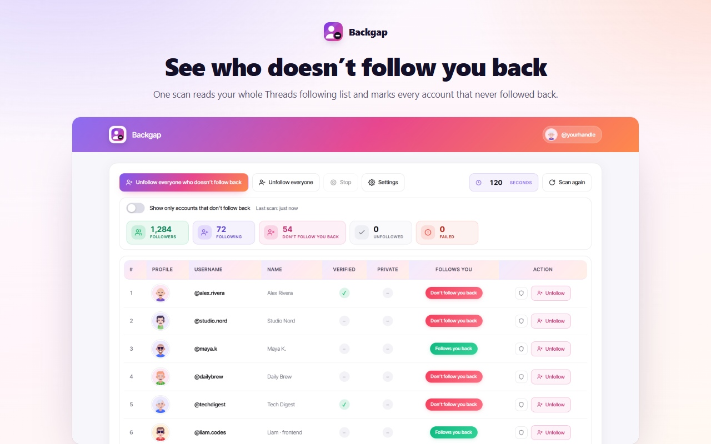
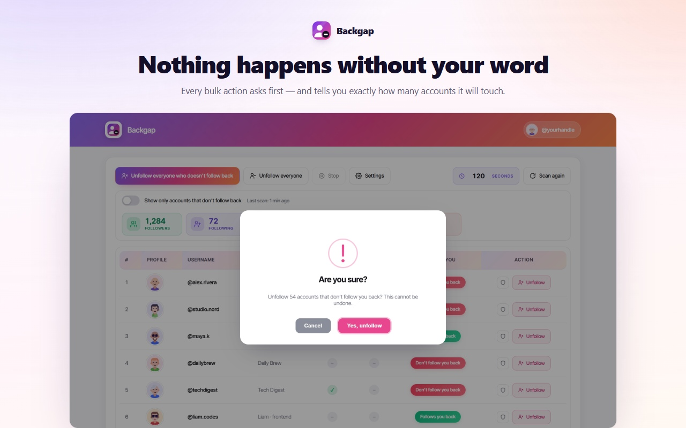
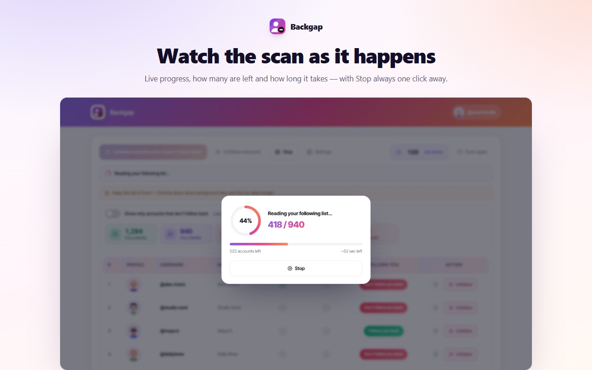
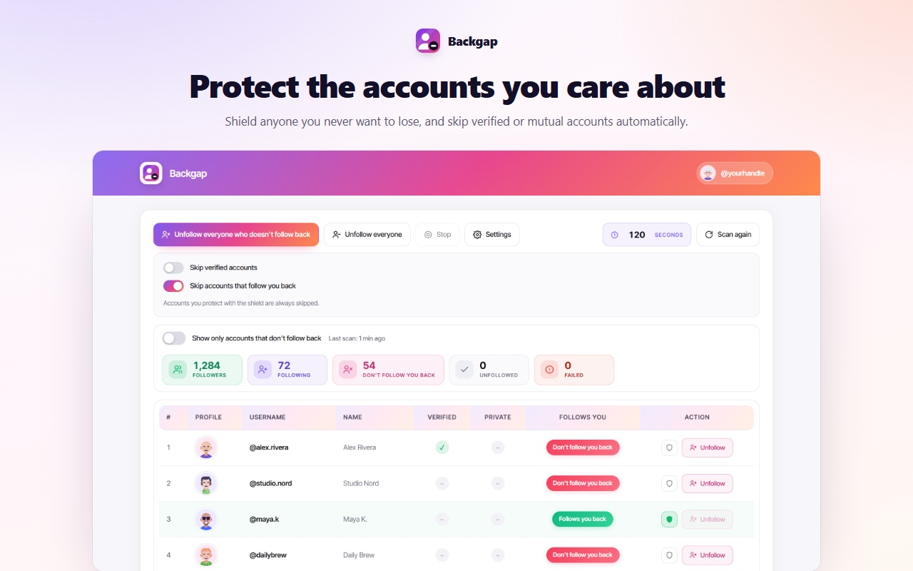
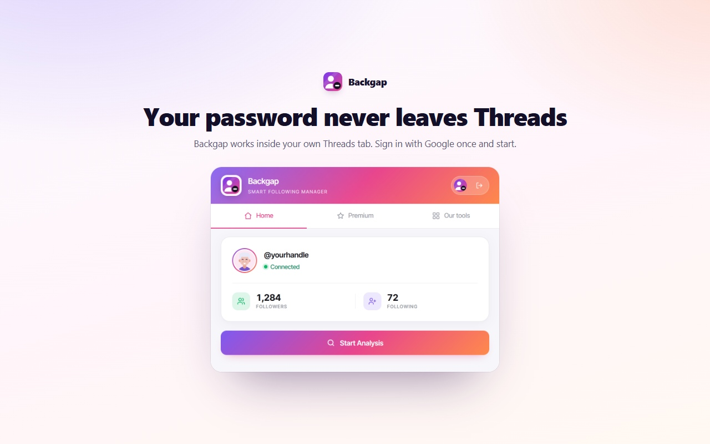

# Backgap: Threads Followers Tracker & Mass Unfollow

Threads shows you a follower count, never a list of who never followed back. Backgap is a Chrome extension that scans your whole Threads following list, marks every account that doesn't follow you back, and unfollows the ones you choose, in bulk or one at a time, at a pace you set, without ever asking for your password.

<a href="https://chromewebstore.google.com/detail/bmeafenkfecifelodccbcagniicamaim?utm_source=github&utm_medium=readme&utm_campaign=backgap">Chrome Web Store</a> | <a href="https://www.addonschrome.com/extensions/backgap-threads-followers-tracker-mass-unfollow.html?utm_source=github&utm_medium=readme&utm_campaign=backgap">Full guide and FAQ</a> | <a href="https://www.youtube.com/watch?v=QIePorrHDvA">Video demo</a>

This repository is the public home for Backgap documentation, release notes and the issue tracker. The extension itself is distributed through the Chrome Web Store.

## Features

- **See every non-follower.** One scan reads your whole following list. The table shows username, display name, follower count, verified, private, and whether each account follows you.
- **Unfollow in bulk, or one at a time.** Clear everyone who doesn't follow back in a single run, work through your entire following list, or use the button on a single row.
- **You set the pace.** Choose the delay between actions, anywhere from 5 to 600 seconds.
- **Shield the accounts you can't lose.** Shielded accounts are skipped in every bulk run; the shield survives restarts and new scans.
- **Skip verified and mutual accounts.** Two switches keep verified accounts and people who follow you back out of every bulk action.
- **Stop whenever you want.** Stop takes effect on the next action, during both the scan and the unfollow run.
- **Live progress.** Accounts read, accounts left, percentage done and estimated time remaining.
- **50+ interface languages**, including right-to-left layouts.
- Works on both threads.com and threads.net.

## How to use

1. Install Backgap from the Chrome Web Store and sign in with Google (keeps your settings and shielded accounts attached to you).
2. Open Threads in the same browser, signed in to your own account, and press **Start**. If no Threads tab is open, Backgap opens one.
3. Let the scan read your following and followers lists.
4. Sort and filter the table, and shield anyone you want to keep.
5. Pick the delay, press the bulk button and confirm. Every bulk action shows the exact number first.

## Pricing

Backgap is free to install from the Chrome Web Store.

## Privacy

Backgap never asks for your Threads password. It works inside the Threads tab you are already signed in to. Signing in with Google is only used to identify your account.

## Responsible use

Use a pace that resembles ordinary activity. If Threads asks for a slower pace, Backgap pauses, shows a countdown and continues on its own.

## Screenshots

## Support

Found a bug or have a feature request? [Open an issue](../../issues).

## Disclaimer

Threads and Instagram are trademarks of Meta Platforms, Inc. Backgap is an independent extension and is not affiliated with, endorsed by or sponsored by Threads, Instagram or Meta.

---

Built and maintained by [Addons Chrome](https://www.addonschrome.com/?utm_source=github&utm_medium=readme&utm_campaign=backgap).
